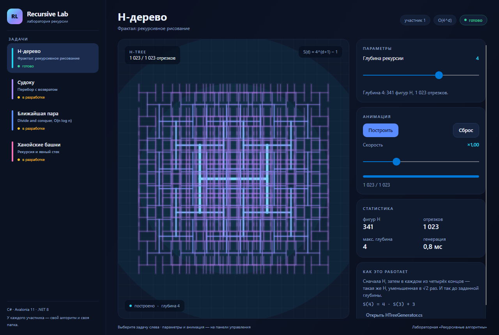
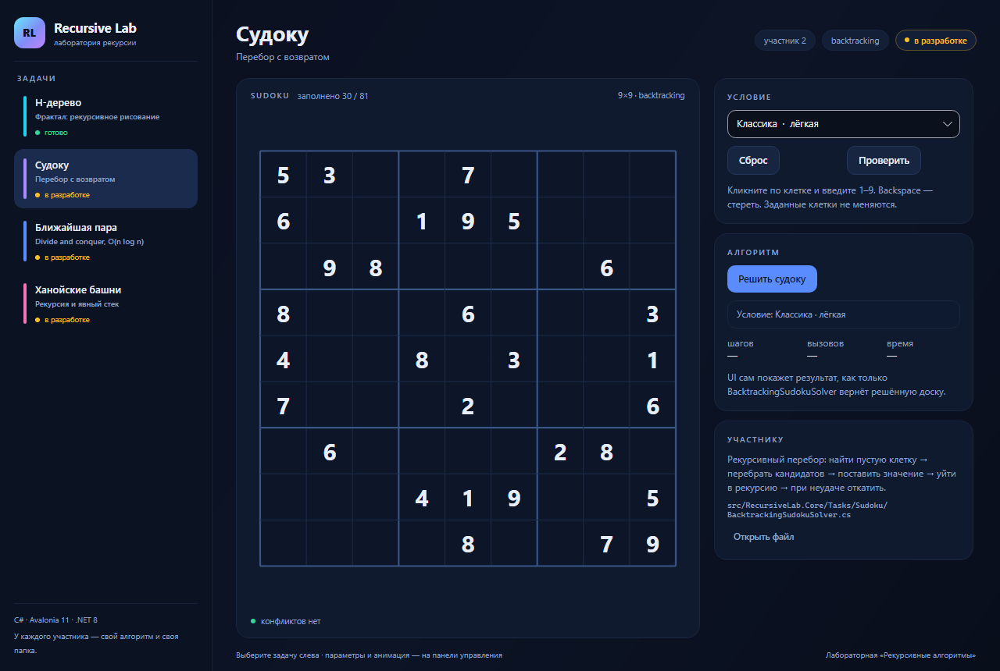
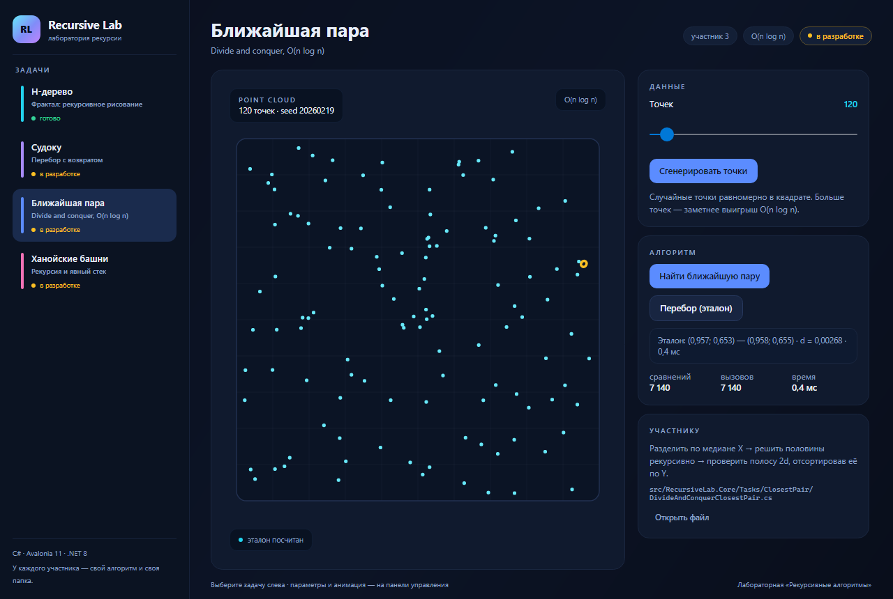
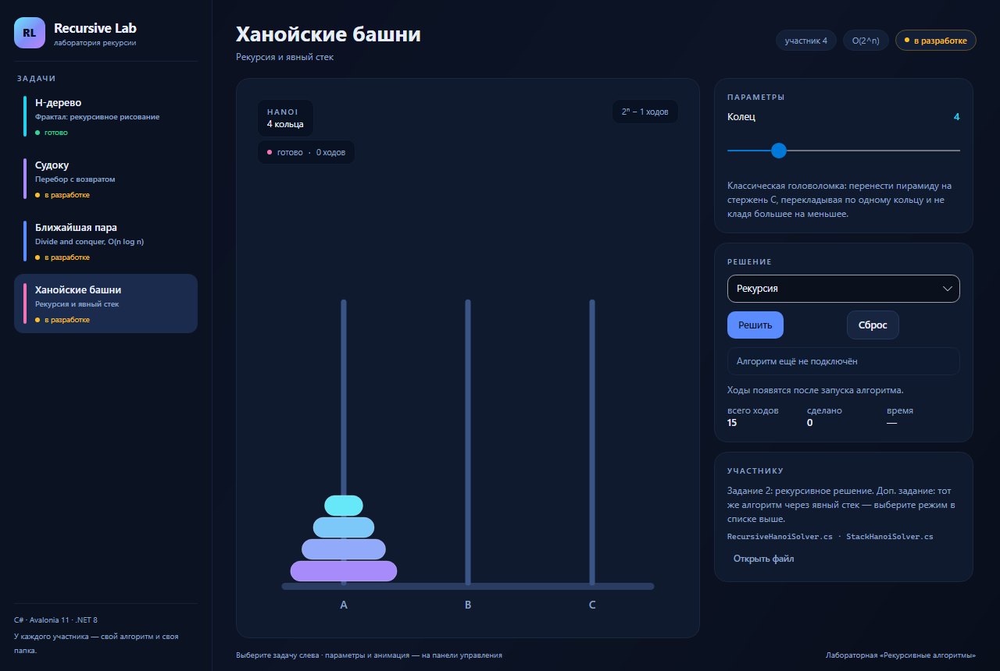

# Recursive Lab — лаборатория рекурсивных алгоритмов

[](https://github.com/ZHEEZL/second/actions/workflows/ci.yml)

Оконное приложение на C# (Avalonia 11, .NET 8) для лабораторной работы
«Рекурсивные алгоритмы». Один каркас — четыре задачи. У каждой задачи свой
участник, своя страница и **свой файл с алгоритмом**: участники не мешают
друг другу и не конфликтуют в git.



## Задачи

| Задача | Автор | Статус | Файл алгоритма |
|--------|-------|--------|----------------|
| H-дерево (фрактал) | участник 1 | готово | `src/RecursiveLab.Core/Tasks/HTree/HTreeGenerator.cs` |
| Судоку | участник 2 | UI готов, алгоритм — TODO | `src/RecursiveLab.Core/Tasks/Sudoku/BacktrackingSudokuSolver.cs` |
| Ближайшая пара точек | участник 3 | UI готов, алгоритм — TODO | `src/RecursiveLab.Core/Tasks/ClosestPair/DivideAndConquerClosestPair.cs` |
| Ханойские башни | участник 4 | UI готов, алгоритм — TODO | `src/RecursiveLab.Core/Tasks/Hanoi/RecursiveHanoiSolver.cs` |

> Имена авторов, статусы и порядок задач меняются в одном месте:
> `src/RecursiveLab.App/Services/LabTaskCatalog.cs`.

Ханойские башни добавлены, потому что это **обязательное задание 2** из PDF
лабораторной. Если в команде пока нет человека на эту задачу — см.
[`docs/TASK-HANOI.md`](docs/TASK-HANOI.md).

## Что умеет приложение

- **H-дерево.** Глубина 0–6, анимация «рисования по рекурсии» (кнопка
  «Построить»), пауза, скорость, счётчики H-фигур/отрезков, время генерации.
  Цвет и толщина линий показывают уровень рекурсии.
- **Судоку.** Ввод с клавиатуры, подсветка строки/столбца/квадрата, поиск
  конфликтов, готовые условия. Как только алгоритм реализован — кнопка
  «Решить» заполняет доску, а панель показывает число шагов/вызовов/время.
- **Ближайшая пара.** Генерация случайных точек (10–2000), кнопка
  «Перебор (эталон)» для проверки ответа, подсветка найденной пары. Полоса
  и линия раздела уже умеют рисоваться — их можно использовать для анимации
  шагов алгоритма.
- **Ханойские башни.** Выбор числа колец, режим «рекурсия» / «стек»,
  анимация ходов, счётчики ходов и времени.

## Быстрый старт

Нужен .NET 8 SDK (или новее) и любая IDE: Visual Studio 2022, Rider или VS Code.

```powershell
git clone https://github.com/ZHEEZL/second.git
cd second

dotnet restore
dotnet run --project src/RecursiveLab.App
```

Если `dotnet` в вашей среде не может писать в профиль пользователя
(например, ограниченная песочница), используйте обёртку:

```powershell
.\scripts\dotnet.ps1 run --project src/RecursiveLab.App
```

Тесты:

```powershell
dotnet test
```

Скриншоты без реального окна (headless-рендер):

```powershell
dotnet run --project src/RecursiveLab.Smoke -- artifacts/screenshots
```

## Git и CI

Репозиторий инициализирован: ветка `main`, первый коммит, `.gitignore`.
Подключение GitHub, ветки на каждую задачу, PR, защита `main` и разрешение
конфликтов — в [`docs/GIT-WORKFLOW.md`](docs/GIT-WORKFLOW.md).

CI (`.github/workflows/ci.yml`) на каждый push/PR в `main` собирает Release
и запускает тесты. Шаблон PR — `.github/pull_request_template.md`.

## Структура

```text
RecursiveLab.sln
├── src/
│   ├── RecursiveLab.Core/        # алгоритмы и модели, без UI — можно тестировать отдельно
│   │   ├── Geometry/
│   │   └── Tasks/
│   │       ├── HTree/            # H-дерево (готово)
│   │       ├── Sudoku/           # доска, контракт, заглушка (TODO)
│   │       ├── ClosestPair/      # контракт, перебор-эталон, заглушка (TODO)
│   │       └── Hanoi/            # рекурсия и стек, заглушки (TODO)
│   ├── RecursiveLab.App/         # Avalonia: окно, навигация, тема, страницы
│   └── RecursiveLab.Smoke/       # headless-скриншоты для проверки вёрстки
├── tests/RecursiveLab.Tests/     # xUnit-тесты + контрактные тесты для участников
├── docs/                         # планы, задания участникам, скриншоты
└── scripts/dotnet.ps1            # dotnet с локальными кэшами (для песочниц)
```

## Как участник подключает свой алгоритм

1. Найти свою страницу в приложении — там указан файл с `TODO`.
2. Реализовать метод по контракту из `RecursiveLab.Core`. UI уже написан:
   ему достаточно, чтобы метод вернул результат в ожидаемом формате.
3. Снять `Skip` с контрактного теста в `tests/RecursiveLab.Tests/SolverContractTests.cs`
   (или `ClosestPairReferenceTests.cs`) и убедиться, что `dotnet test` зелёный.
4. Проверить сценарий вручную по чек-листу из `docs/TASK-*.md`.
5. Закоммитить в свою ветку и открыть PR.

Подробный план работы команды, git-флоу и сценарий защиты:
[`docs/TEAM-PLAN.md`](docs/TEAM-PLAN.md).

## Скриншоты

| H-дерево | Судоку |
|----------|--------|
|  |  |

| Ближайшая пара | Ханойские башни |
|----------------|-----------------|
|  |  |

## Документация

- [`docs/TEAM-PLAN.md`](docs/TEAM-PLAN.md) — роли, архитектура, git-флоу, защита.
- [`docs/GIT-WORKFLOW.md`](docs/GIT-WORKFLOW.md) — подключение GitHub, ветки, PR, CI, защита `main`.
- [`docs/DEV-SETUP.md`](docs/DEV-SETUP.md) — окружение, сборка, тесты, типовые проблемы.
- [`docs/TASK-H-TREE.md`](docs/TASK-H-TREE.md) — что уже сделано и как это объяснять.
- [`docs/TASK-SUDOKU.md`](docs/TASK-SUDOKU.md) — задание участнику 2.
- [`docs/TASK-CLOSEST-PAIR.md`](docs/TASK-CLOSEST-PAIR.md) — задание участнику 3.
- [`docs/TASK-HANOI.md`](docs/TASK-HANOI.md) — задание участнику 4 (рекурсия + стек).
- [`docs/IDEAS.md`](docs/IDEAS.md) — идеи, что добавить после сдачи.
