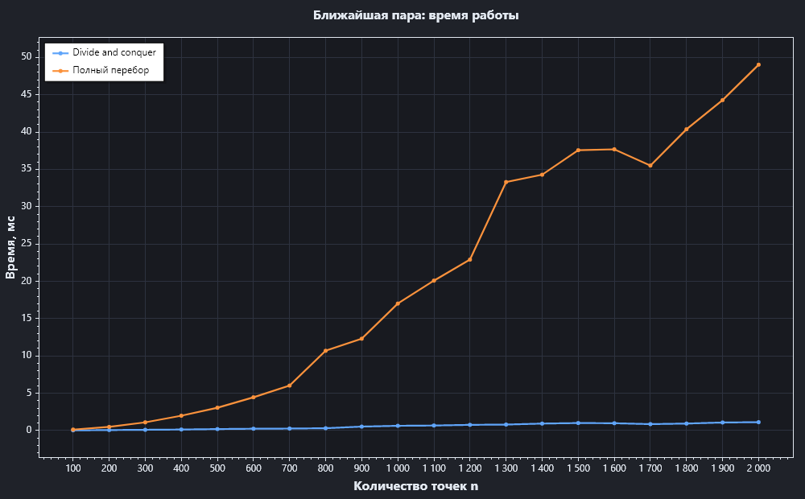
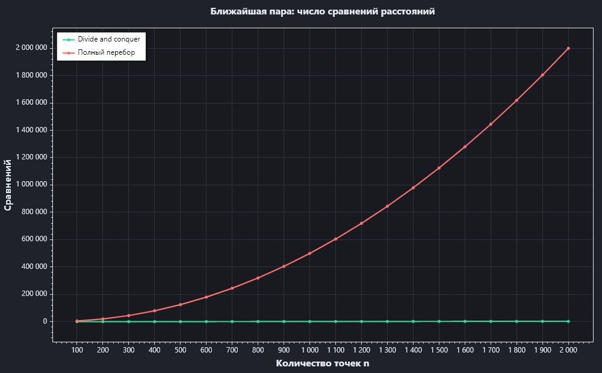
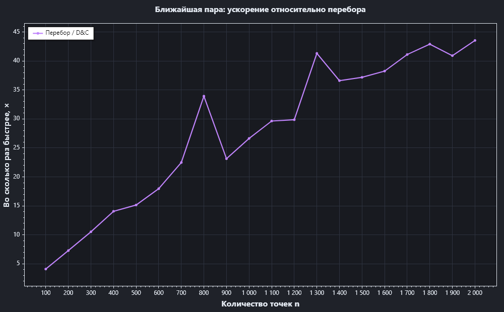

# Ближайшая пара точек — полный отчёт по алгоритму

> Часть лабораторной работы №2 «Рекурсивные алгоритмы».
> Методика замеров и оформление взяты из лабораторной №1: фиксированный seed,
> прогрев, несколько повторов, медиана, CSV и графики ScottPlot в тёмной теме.

## 1. Постановка задачи

Дано множество точек на плоскости:

```text
P = { p₁, p₂, …, pₙ },  pᵢ = (xᵢ, yᵢ)
```

Нужно найти две различные точки `pᵢ` и `pⱼ`, расстояние между которыми
минимально:

```text
d(pᵢ, pⱼ) = √((xᵢ − xⱼ)² + (yᵢ − yⱼ)²)
```

Если точек меньше двух — задача не имеет решения.

**Применение:** компьютерная графика, поиск столкновений, кластеризация,
обработка воздушного движения, проектирование СБИС, проверка минимальных
расстояний между объектами.

## 2. Вход и выход

Контракт проекта:

```csharp
ClosestPairResult Find(
    IReadOnlyList<PointD> points,
    Action<ClosestPairStep>? onStep = null,
    CancellationToken cancellationToken = default);

public sealed record ClosestPairResult(
    PointD A,
    PointD B,
    double Distance,
    long DistanceComparisons,
    long RecursiveCalls,
    TimeSpan Elapsed);
```

- `A`, `B` — найденная пара;
- `Distance` — евклидово расстояние;
- `DistanceComparisons` — сколько раз сравнивались расстояния;
- `RecursiveCalls` — число рекурсивных вызовов;
- `Elapsed` — время работы;
- `onStep` — необязательный callback для анимации шагов;
- `points.Count < 2` → `ArgumentException`.

## 3. Идея алгоритма

### 3.1. Разделяй и властвуй

1. Сортируем точки по `X` (при равных `X` — по `Y`).
2. Делим массив пополам по индексу: `mid = lo + count / 2`.
3. Рекурсивно находим ближайшую пару в левой и правой половинах:
   `dL` и `dR`.
4. Берём `d = min(dL, dR)`.
5. Осталось проверить пары, у которых одна точка слева, а другая справа.
   Если `|x₁ − x₂| ≥ d`, такая пара заведомо не лучше `d`. Поэтому
   рассматриваем только точки в полосе шириной `2d` вокруг `midX`.
6. Точки полосы сортируем по `Y` и сравниваем только те, у которых
   `|y₁ − y₂| < d`.

Для маленьких частей (`≤ 3` точки) работает обычный перебор — это база
рекурсии.

### 3.2. Полоса

Пусть `midX` — `X` точки, разделившей массив. В полосу попадают точки с

```text
|x − midX| < d
```

Если пара пересекает границу, но обе точки лежат вне полосы, то
`|x₁ − x₂| ≥ d`, значит и расстояние не меньше `d` — она не может улучшить
ответ. Значит, все потенциально лучшие «пересекающие» пары находятся
в полосе.

### 3.3. Почему хватает постоянного числа соседей

Полоса имеет ширину `2d`. Если отсортировать её по `Y`, то для каждой точки
достаточно проверить следующие точки, пока `dy < d`. В прямоугольнике
`2d × d` не может быть слишком много точек, попарно удалённых друг от друга
не меньше чем на `d` (упаковочный аргумент): обычно говорят «не более 7
следующих». Поэтому внутренний цикл не вырождается в `O(n²)`.

## 4. Псевдокод

```text
Find(points):
    если n < 2: ошибка
    arr = копия points
    отсортировать arr по (X, затем Y)

    best = Solve(arr, 0, n)
    вернуть (best.A, best.B, √best.DistSq,
             comparisons, calls, elapsed)

Solve(arr, lo, hi):                 // [lo, hi)
    calls++
    count = hi − lo

    если count ≤ 3:
        перебор всех пар в arr[lo..hi)
        вернуть лучшую

    mid  = lo + count / 2
    midX = arr[mid].X

    left  = Solve(arr, lo, mid)
    right = Solve(arr, mid, hi)
    best  = min(left, right)

    strip = точки arr[lo..hi), где (X − midX)² < best.DistSq
    отсортировать strip по Y

    для i от 0 до strip.Count−1:
        для j от i+1, пока (strip[j].Y − strip[i].Y)² < best.DistSq:
            comparisons++
            d² = расстояние² между strip[i] и strip[j]
            если d² < best.DistSq:
                best = (strip[i], strip[j], d²)

    вернуть best
```

## 5. Корректность

Докажем индукцией по `n`.

**База.** Для `n ≤ 3` перебираются все пары, значит лучшая найдена.

**Переход.** Пусть `n > 3`. Любая пара точек попадает в один из трёх классов:

1. обе точки в левой половине — по индукции лучшая там найдена;
2. обе в правой — аналогично;
3. точки в разных половинах.

Для третьего класса: если `|x₁ − x₂| ≥ d`, то расстояние между точками
не меньше `d`, поэтому такая пара не улучшает текущий минимум. Остаются
пары с `|x₁ − x₂| < d` — обе точки в полосе. Алгоритм перебирает все пары
полосы, у которых `|y₁ − y₂| < d`; у пар с `|y₁ − y₂| ≥ d` расстояние тоже
не меньше `d`. Значит, все потенциально лучшие пары рассмотрены.

Следовательно, возвращается действительно ближайшая пара.

## 6. Сложность

- Сортировка по `X`: `O(n log n)`.
- Рекурсия: два вызова по `n/2`.
- На каждом уровне полоса сортируется по `Y`: `O(n log n)` на уровень.

Итог для текущей реализации:

```text
T(n) = 2·T(n/2) + O(n log n) = O(n log² n)
```

Если один раз отсортировать все точки по `Y` и передавать этот порядок в
рекурсию (или сливать половины), сортировка полосы становится линейной,
и получается классическая оценка:

```text
T(n) = 2·T(n/2) + O(n) = O(n log n)
```

Память: `O(n)` на массивы и полосы (плюс `O(log n)` глубина рекурсии).

Именно поэтому в интерфейсе указан целевой класс `O(n log n)`; текущая
реализация при этом остаётся в `O(n log² n)` из-за сортировки полосы на
каждом уровне. Это приемлемо для лабораторной и объяснено в отчёте.

## 7. Реализация в проекте

| Компонент | Файл |
|-----------|------|
| Алгоритм | `src/RecursiveLab.Core/Tasks/ClosestPair/DivideAndConquerClosestPair.cs` |
| Контракт и шаги | `src/RecursiveLab.Core/Tasks/ClosestPair/ClosestPairModels.cs` |
| Эталонный перебор | `src/RecursiveLab.Core/Tasks/ClosestPair/ClosestPairReference.cs` |
| Страница и анимация | `src/RecursiveLab.App/Views/Pages/ClosestPairPage.axaml(.cs)` |
| Отрисовка точек/полосы | `src/RecursiveLab.App/Controls/PointsCanvas.cs` |
| Тесты | `tests/RecursiveLab.Tests/ClosestPairReferenceTests.cs` |

Что сделано:

- рекурсивный `Solve` с базой `≤ 3`;
- сортировка по `X`, полоса по `Y`;
- счётчики сравнений и рекурсивных вызовов;
- шаги `Split` / `BaseCase` / `Strip` / `BestChanged` / `Done` для UI;
- анимация шагов и ползунок скорости;
- тест на совпадение с перебором на 25 случайных наборах;
- тесты крайних случаев: 2 точки, дубликаты, точки на одной прямой.

## 8. Методика измерений

Стенд: `benchmarks/RecursiveLab.Benchmarks` (консольный проект .NET 8).

Методика повторяет лабораторную №1:

- фиксированный seed — одинаковые точки для обоих алгоритмов;
- `n = 100..2000` с шагом `100`;
- 5 независимых повторов на каждую точку;
- прогрев JIT и структур данных перед замером;
- для быстрых вызовов — несколько повторений внутри одного замера
  (batch), время делится на число повторов;
- результат точки — медиана по повторам, дополнительно считается σ;
- `GC.Collect()` перед серией;
- `<TieredCompilation>false</TieredCompilation>`;
- сравнение с эталонным перебором `O(n²)`;
- экспорт в CSV и графики ScottPlot.

Запуск:

```powershell
dotnet run --project benchmarks/RecursiveLab.Benchmarks
```

Результаты: `benchmarks/results/closest-pair.csv` и `summary.md`,
графики — `docs/charts/`.

**Окружение:** Windows 11 (10.0.26300), .NET 8, AMD Ryzen 9 7845HX
(12 ядер / 24 потока).

## 9. Результаты измерений

| n | D&C, мс | D&C σ | D&C сравнений | Перебор, мс | Перебор σ | Перебор сравнений | Ускорение |
|---:|---:|---:|---:|---:|---:|---:|---:|
| 100 | 0,032 | 0,004 | 129 | 0,131 | 0,011 | 4 950 | ×4,1 |
| 200 | 0,067 | 0,008 | 282 | 0,494 | 0,003 | 19 900 | ×7,3 |
| 300 | 0,106 | 0,002 | 344 | 1,114 | 0,016 | 44 850 | ×10,5 |
| 400 | 0,141 | 0,001 | 534 | 1,973 | 0,009 | 79 800 | ×14,0 |
| 500 | 0,205 | 0,007 | 548 | 3,074 | 0,016 | 124 750 | ×15,0 |
| 600 | 0,250 | 0,006 | 748 | 4,407 | 0,097 | 179 700 | ×17,6 |
| 700 | 0,271 | 0,002 | 914 | 6,012 | 0,019 | 244 650 | ×22,2 |
| 800 | 0,315 | 0,005 | 1 086 | 10,265 | 1,295 | 319 600 | ×32,6 |
| 900 | 0,542 | 0,016 | 1 097 | 12,795 | 0,748 | 404 550 | ×23,6 |
| 1000 | 0,626 | 0,052 | 1 137 | 17,461 | 0,719 | 499 500 | ×27,9 |
| 1100 | 0,755 | 0,029 | 1 307 | 23,651 | 2,116 | 604 450 | ×31,3 |
| 1200 | 0,803 | 0,060 | 1 455 | 26,824 | 1,247 | 719 400 | ×33,4 |
| 1300 | 0,854 | 0,028 | 1 634 | 33,051 | 3,993 | 844 350 | ×38,7 |
| 1400 | 0,957 | 0,034 | 1 849 | 34,105 | 2,934 | 979 300 | ×35,6 |
| 1500 | 1,025 | 0,060 | 2 093 | 40,364 | 4,125 | 1 124 250 | ×39,4 |
| 1600 | 1,200 | 0,065 | 2 187 | 45,034 | 0,942 | 1 279 200 | ×37,5 |
| 1700 | 1,278 | 0,066 | 2 167 | 54,099 | 6,373 | 1 444 150 | ×42,3 |
| 1800 | 1,263 | 0,076 | 2 207 | 50,799 | 2,074 | 1 619 100 | ×40,2 |
| 1900 | 1,386 | 0,032 | 2 260 | 60,939 | 2,466 | 1 804 050 | ×44,0 |
| 2000 | 1,419 | 0,013 | 2 265 | 62,416 | 2,273 | 1 999 000 | ×44,0 |

Аппроксимация:

- D&C: `t(n) ≈ C·n·log₂n`, `C = 6,4886·10⁻⁵ мс`, `MSE = 5,62·10⁻³`;
- перебор: `t(n) ≈ C·n²`, `C = 1,6976·10⁻⁵ мс`, `MSE = 6,37`.

При `n = 2000`:

```text
D&C:      1,419 мс, 2 265 сравнений
Перебор: 62,416 мс, 1 999 000 сравнений
Ускорение: ×44 по времени, ≈ ×880 по числу сравнений
```

Разброс ускорения (например, «просадка» на n = 900) объясняется разными
случайными наборами для каждого n и шумом таймера; общий тренд — быстрый
рост преимущества.

### График времени



### График числа сравнений



### График ускорения



## 10. Демонстрация работы

Демонстрация встроена в приложение:


1. `dotnet run --project src/RecursiveLab.App`.
2. Открыть вкладку **«Ближайшая пара»**.
3. Выбрать количество точек (10–2000) и нажать **«Сгенерировать точки»**.
4. Нажать **«Найти ближайшую пару»** — проигрывается анимация шагов:
   линия раздела, полоса, смена лучшей пары.
5. Ползунком **«Скорость»** регулировать темп анимации.
6. Кнопка **«Перебор (эталон)»** показывает контрольный ответ `O(n²)`.

## 11. Выводы

- Divide and conquer даёт ощутимый выигрыш уже на сотнях точек:
  при `n = 2000` — примерно в 44 раза быстрее перебора.
- Число сравнений расстояний растёт как `O(n log n)` (в текущей реализации
  с сортировкой полосы — `O(n log² n)`), а у перебора — как `O(n²)`.
- Практическая реализация совпадает с теорией по порядку роста; отклонения
  объясняются шумом измерений и случайными наборами.
- Основная оптимизация на будущее — один раз отсортировать точки по `Y`
  и не сортировать полосу на каждом уровне.

## 12. Источники

1. Cormen T., Leiserson C., Rivest R., Stein C. *Introduction to Algorithms*,
   3rd ed. — MIT Press, 2009. — §33.4 «Finding the closest pair of points».
2. Wikipedia: [Closest pair of points problem](https://en.wikipedia.org/wiki/Closest_pair_of_points_problem).
3. Лабораторная работа №1 (стенд замеров, ScottPlot, CSV, отчёт) —
   использована как образец методики измерений и оформления.
